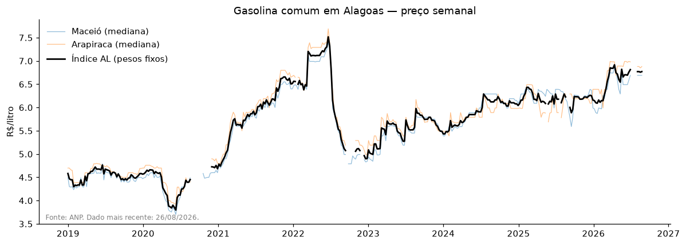
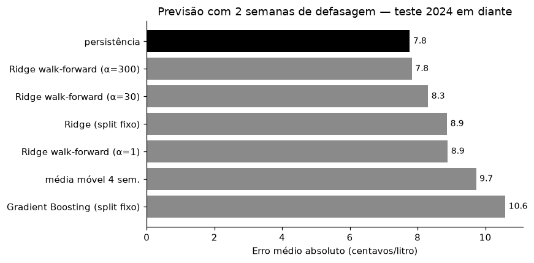
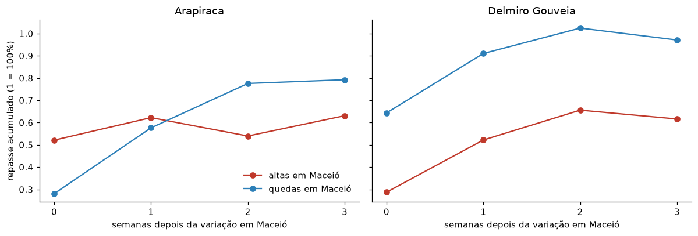
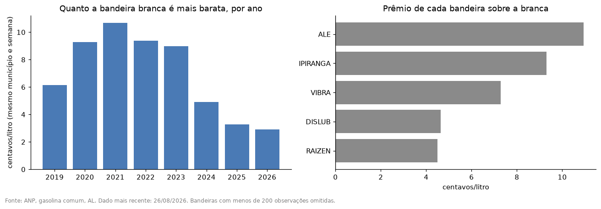

# Preço da gasolina em Alagoas: dá para prever?

Análise de 7 anos e meio de preços de gasolina em Alagoas (jan/2019 a ago/2026)
com a Série Histórica de Preços de Combustíveis da ANP, pensando em quem
depende do tanque para trabalhar: motoristas de aplicativo e motoboys.

**Perguntas**

1. Dá para prever o preço médio da gasolina em AL nas próximas semanas?
2. O preço no interior acompanha Maceió do mesmo jeito na alta e na queda?
3. Posto de bandeira branca é mesmo mais barato?



## Principais resultados

| | Resultado |
|---|---|
| **Previsão** | Nenhum modelo bateu a persistência ("o preço da próxima semana é o último publicado"). Com 2 semanas de defasagem da ANP, a persistência erra em média **7,8 centavos/litro** em 2024–2026. Ridge e Gradient Boosting erram entre 8,3 e 10,6. |
| **H2: bandeira branca** | **Confirmada.** No mesmo município e na mesma semana, a branca sai **~7 centavos/litro mais barata** (IC 95%: 6,9 a 7,9) e é a mais barata em 85% das comparações. A vantagem caiu de ~10 centavos (2021–2022) para ~3 centavos (2025–2026). |
| **H1: assimetria de repasse** | **Não confirmada.** Não há evidência estatística de que as altas de Maceió cheguem ao interior mais rápido que as quedas (p ≈ 0,3). |

<p>


</p>



### O que isso significa

O resultado negativo na previsão é o mais útil do projeto. As variações do
preço de bomba vêm em degraus provocados por choques externos (reajuste da
Petrobras nas refinarias, ICMS, câmbio), e o histórico do próprio preço não
antecipa esses degraus. Quanto mais regularizado o modelo, mais ele converge
para "variação = 0", ou seja, para a persistência. Uma recomendação de
"abastecer agora ou esperar" baseada só em preço de bomba prometeria uma
precisão que os dados não sustentam. O próximo passo é usar como variável os
anúncios de reajuste da Petrobras, que são públicos e saem antes de chegar
à bomba.

## Metodologia: os cuidados que mudam o resultado

Os dados da ANP parecem simples, mas têm armadilhas que, ignoradas, geram
conclusões erradas. Detalhes em [docs/observacoes_base.md](docs/observacoes_base.md).

- **Defasagem de publicação.** A ANP publica com cerca de 1 a 2 semanas de
  atraso. O modelo só usa o que já estaria publicado no momento da previsão.
  Passar de 1 para 2 semanas de atraso aumenta o erro em ~50%.
- **Split temporal, nunca aleatório.** Treino em 2019–2023 e teste em
  2024–2026, mais um esquema walk-forward retreinado toda semana. A
  normalização é ajustada só no treino.
- **Amostra que muda no tempo.** A pesquisa é amostral: municípios do interior
  somem por meses seguidos (Palmeira dos Índios ficou fora o ano de 2021
  inteiro). Uma média estadual simples mistura variação de preço com variação
  de composição; em 18 semanas isso moveu a média em mais de 5 centavos. Por
  isso a série-alvo é um **índice de pesos fixos** com os dois municípios de
  cobertura contínua, usando a **mediana** dos postos em vez da média.
- **Comparações controladas.** A H2 compara branca contra bandeirada dentro da
  mesma célula município × semana, para não confundir bandeira com localização
  ou época.
- **De-para de bandeira.** BR Distribuidora → Vibra Energia → Vibra e
  Alesat → ALE aparecem como empresas diferentes nos dados brutos. Sem
  harmonizar os nomes, a mesma empresa vira três concorrentes.
- **Gasolina comum e aditivada separadas.** São ~54 centavos de diferença; a
  série-alvo usa só a comum.

## Estrutura

```
src/download.py      baixa os arquivos semestrais da ANP (com retry e retomada)
src/load.py          lê os arquivos, normaliza, valida, faz o de-para de bandeira e filtra AL
src/series.py        monta as séries semanais por município e o índice de pesos fixos
notebooks/
  00_diagnostico           qualidade, esquema, latência e nulos da base
  01_cobertura_amostral    quantos postos a ANP pesquisa por município e semana
  02_baseline_previsao     persistência × média móvel × Ridge × Gradient Boosting
  03_hipoteses             testes da H2 (bandeira branca) e da H1 (repasse)
docs/                dicionário de dados, canvas de catalogação, observações e figuras
```

## Como reproduzir

```bash
python -m venv .venv
source .venv/bin/activate        # Windows: .venv\Scripts\activate
pip install -r requirements.txt

python src/download.py --inicio 2019 --fim 2026   # semestres (~530 MB)
python src/download.py --ultimas-semanas          # arquivo mais recente
python src/load.py                                # gera data/processed/*.parquet
jupyter lab notebooks/
```

Os dados não estão no repositório: são baixados direto da ANP.

## Limitações

- A pesquisa da ANP cobre só **5 municípios** de AL e uma amostra dos postos.
  As conclusões valem para os postos pesquisados, não para o mercado inteiro.
- O interior tem de 7 a 14 postos por semana; o teste da H1 tem pouco poder
  estatístico.
- O preço de compra (distribuidora) deixa de ser divulgado em ago/2020, por
  isso não há análise de margem.
- Os resultados são agregados por município e bandeira. O projeto não publica
  ranking de postos individuais: a amostra é parcial e o efeito reputacional
  seria real.

## Ferramentas

Python · pandas · scikit-learn · statsmodels · matplotlib · Jupyter

## Fonte

ANP, [Série Histórica de Preços de Combustíveis](https://www.gov.br/anp/pt-br/centrais-de-conteudo/dados-abertos/serie-historica-de-precos-de-combustiveis)
(dados abertos). Dado mais recente usado: coleta de 26/08/2026.

Projeto desenvolvido no curso de Ciência de Dados da OxeTech.
